# HỆ THỐNG KIẾN TRÚC TỔNG THỂ — CHINESE VIRAL VIDEO FACTORY (CVVF)

**Version:** 1.0.0  
**Status:** DRAFT & ACTIVE ARCHITECTURE  
**Target Project:** `CHINESE_VIRAL_VIDEO_FACTORY`  
**Namespace:** `cvvf`  

---

## 1. TỔNG QUAN KIẾN TRÚC & NGUYÊN TẮC CỐT LÕI

Hệ thống `CHINESE_VIRAL_VIDEO_FACTORY` (CVVF) được thiết kế theo mô hình **Modular Micro-Services & Pipeline Architecture**, kết hợp giữa:
- **Core Engine (Python 3.11):** Đảm nhiệm logic nghiệp vụ, adapter nguồn, phân loại, chấm điểm viral, ASR/dịch thuật, TTS và FFmpeg render.
- **Data Layer (PostgreSQL / SQLite dual-mode):** Hỗ trợ phát triển và kiểm thử hoàn toàn độc lập mà không bắt buộc phụ thuộc dịch vụ ngoài.
- **Workflow / Automation Bridge:** Cung cấp API/Webhook tiêu chuẩn để tích hợp n8n trong tương lai mà không sửa đổi bất kỳ workflow n8n hiện có nào.
- **Control Center (P6 UI/API):** Theo dõi trạng thái, kiểm soát ngân sách, duyệt nội dung và kích hoạt tái xử lý an toàn.

### Ba Nguyên Tắc Bất Di Bất Dịch:
1. **Bảo tồn hình ảnh gốc (Pixel Preservation):** Không dùng AI (Veo, Flow, Midjourney...) tạo lại hình ảnh video trong luồng chuẩn. Hình ảnh nguồn được giữ nguyên gốc 100%.
2. **Không phát sinh chi phí ngầm (Zero Unverified Cost):** Mặc định sử dụng công cụ cục bộ miễn phí (FFmpeg, Whisper cục bộ/miễn phí, heuristic algorithm). Chỉ gọi API ngoài khi đã cấu hình quota, token limit và xác minh chi phí thực tế.
3. **Phê duyệt độc quyền của người dùng (Human-in-the-Loop):** Hệ thống không tự động xuất bản (publish) lên mạng xã hội khi chưa có xác nhận quyền tác giả và phê duyệt kiểm duyệt từ người dùng.

---

## 2. KIẾN TRÚC PHÂN TẦNG (LAYERED ARCHITECTURE)

```mermaid
graph TD
    subgraph S1["Tầng Nguồn (Source Adapters)"]
        A1["Douyin Adapter"]
        A2["Kuaishou Adapter"]
        A3["Bilibili / RedBook Adapter"]
        A4["Public Feeds / Media Syndication"]
    end

    subgraph S2["Tầng Xử Lý Dữ Liệu (Discovery & Scoring)"]
        B1["Deduplication & Canonical Key Engine"]
        B2["Taxonomy Classifier v1.0.0"]
        B3["Viral Potential Scoring Engine"]
        B4["Review Candidate Store"]
    end

    subgraph S3["Tầng Xử Lý Ngôn Ngữ (ASR & Subtitles)"]
        C1["Audio Demux (FFmpeg local)"]
        C2["Chinese ASR Engine (Whisper/Adapter)"]
        C3["Vietnamese Localization & Glossary"]
        C4["SRT Generator & Alignment Validator"]
    end

    subgraph S4["Tầng Lồng Tiếng & Âm Thanh (Dubbing & Mixing)"]
        D1["Vietnamese TTS Adapter"]
        D2["Speech Tempo & Duration Matcher"]
        D3["BGM Preservation & Audio Ducking"]
    end

    subgraph S5["Tầng Hoàn Thiện & Kiểm Định (Render & QC)"]
        E1["FFmpeg Render Worker"]
        E2["QC Engine (Codecs, Bitrate, Drift Check)"]
        E3["Artifact Store (Original / Vietsub / Dubbed)"]
    end

    subgraph S6["Tầng Quản Trị & Kiểm Soát (Control Center)"]
        F1["Task Orchestrator & Idempotency Guard"]
        F2["Cost Monitor & Safe Circuit Breakers"]
        F3["Human Approval & Content Rights Gate"]
        F4["Dashboard UI / REST Endpoints"]
    end

    S1 --> S2
    S2 --> S3
    S3 --> S4
    S4 --> S5
    S5 --> S6
```



---

## 3. THIẾT KẾ CHI TIẾT TỪNG MODULE

### 3.1. Discovery Adapter Module (P1)
- **Adapter Interface:**
  - `fetch_trending(page, page_size, dry_run=False) -> List[RawVideoItem]`
  - `fetch_by_id(item_id) -> Optional[RawVideoItem]`
- **Chuẩn hóa dữ liệu (Standard Schema):**
  - `source_platform`: Tên nền tảng (`douyin`, `kuaishou`, `bilibili`, `feed_syndication`).
  - `source_item_id`: ID gốc từ nguồn.
  - `canonical_url`: URL gốc chuẩn.
  - `author_name`, `author_id`, `author_verified`: Metadata tác giả.
  - `raw_metrics`: Dict chứa lượt xem, like, comment, share (ghi nhận `None` nếu nguồn không cung cấp).
  - `rights_status`: Mặc định `PENDING_REVIEW` hoặc `PUBLIC_ACCESSIBLE`.
  - `dedup_hash`: `sha256(source_platform + ":" + source_item_id)`.
- **Kiểm soát rủi ro:**
  - Rate limiting dùng Token Bucket thuật toán nội bộ.
  - Exponential backoff với jitter ngẫu nhiên khi gặp mã lỗi 429 hoặc 503.
  - Timeout tối đa 15s cho mỗi network call.

### 3.2. Classification & Viral Scoring Module (P2)
- **Taxonomy Versioning:** Cấu trúc phân loại có phiên bản (`taxonomy_v1.0.0.json`).
  - Nhóm chính: `ai_movie`, `short_film`, `drama_series`, `comedy`, `daily_life`, `knowledge`, `animation`, `other`.
- **Nguyên tắc Viral Scoring:**
  - Tách bạch rõ 2 chỉ số: `measured_viral_score` (dựa trên số liệu thực tế) và `inferred_potential_score` (dựa trên heuristic nội dung/chủ đề).
  - Nếu thiếu số liệu tương tác: Trả về trạng thái `INSUFFICIENT_DATA`, không được tự ý gán lượt xem giả định hoặc bịa tỷ lệ tương tác.
  - Trọng số cấu hình linh hoạt qua file cấu hình `config/scoring_rules.yaml`.

### 3.3. Transcription & Vietsub Module (P3)
- **Audio Extraction:** Dùng `ffmpeg -i <video> -vn -acodec pcm_s16le -ar 16000 -ac 1 audio.wav` trực tiếp từ binary FFmpeg 9.0.2 đã có sẵn trên máy.
- **ASR Engine Adapter:** Hỗ trợ pluggable ASR:
  - Local Whisper engine (tận dụng FFmpeg libwhisper hoặc whisper engine).
  - External API adapter (Google AI / Whisper API) - chỉ kích hoạt khi có token và ngân sách cho phép.
- **Dịch thuật & Thuật ngữ (Translation & Glossary):**
  - Adapter dịch tiếng Trung -> tiếng Việt theo ngữ cảnh văn phong tự nhiên.
  - Glossary dictionary cho danh từ riêng, đại từ xưng hô, thành ngữ tiếng Trung phổ biến.
- **SRT & JSON Schema:**
  - Sinh file `.srt` chuẩn UTF-8 kèm timestamp millisecond.
  - Bộ kiểm định (Subtitle Validator): Bắt lỗi khoảng thời gian chồng chéo (overlap), độ dài phụ đề vượt quá 45 ký tự/dòng, hoặc ký tự rác.

### 3.4. Vietnamese Dubbing Module (P4)
- **TTS Adapter:** Kiến trúc kết nối đa nguồn giọng (Edge TTS / Local Voice / Cloud TTS).
- **Căn chỉnh thời lượng (Tempo Matching):**
  - Tự động đo thời lượng câu nói tiếng Trung và so sánh với câu TTS tiếng Việt.
  - Dùng bộ lọc `atempo` của FFmpeg để tăng/giảm tốc độ trong ngưỡng an toàn (0.85x - 1.25x) tránh méo giọng.
- **Giữ nhạc nền (BGM Preservation):**
  - Áp dụng kỹ thuật ducking (giảm âm lượng BGM xuống 20% khi có giọng lồng tiếng, phục hồi 100% ở đoạn nghỉ).
  - Nếu cần tách giọng nói gốc khỏi nhạc nền: Sử dụng adapter Demucs hoặc công cụ tách âm thanh cục bộ.

### 3.5. Rendering & Quality Control Module (P5)
- **Rendering Worker:**
  - Không ghi đè video gốc (`ORIGINAL_PRESERVED.mp4`).
  - Xuất ra 2 biến thể riêng biệt:
    1. `video_vietsub.mp4`: Video gốc + Subtitle tiếng Việt (softsub hoặc hardsub chất lượng cao).
    2. `video_dubbed_vietsub.mp4`: Video gốc + Audio lồng tiếng Việt + BGM cân chỉnh + Subtitle.
- **Kiểm định chất lượng (QC Automated Checks):**
  - Xác nhận video xuất ra có dung lượng > 0, có thể play bằng ffprobe.
  - Kiểm tra codec (`h264`, `aac`), đúng frame rate và resolution gốc.
  - Tính mã băm SHA-256 để đảm bảo tính toàn vẹn (integrity).

### 3.6. Control Center & Human-in-the-Loop Operations (P6)
- **Trạng thái quy trình (Workflow State Machine):**
  `DISCOVERED` -> `SCORED` -> `AWAITING_REVIEW` -> `SUBTITLED` -> `DUBBED` -> `RENDERED` -> `APPROVED_BY_USER` -> `PUBLISHED`.
- **Bảo vệ chi phí (Budget Circuit Breaker):**
  - Ngưỡng giới hạn chi phí hàng ngày (ví dụ: $0/ngày cho chế độ offline/local, tối đa $5/ngày nếu bật cloud).
  - Tự động ngắt (circuit open) khi đạt 90% quota.

---

## 4. HỢP ĐỒNG DỮ LIỆU CHUẨN (DATA CONTRACTS)

### `RawVideoItem` (Schema v1.0)
```json
{
  "id": "uuid-v4",
  "dedup_key": "douyin:7428912389123",
  "source_platform": "douyin",
  "source_item_id": "7428912389123",
  "title": "Tên video gốc tiếng Trung",
  "description": "Mô tả nội dung",
  "author": {
    "id": "author_123",
    "name": "Tác giả",
    "url": "https://..."
  },
  "metrics": {
    "views": 520000,
    "likes": 42000,
    "comments": 1200,
    "shares": 3400,
    "collected_at": "2026-10-17T07:00:00Z"
  },
  "media_urls": {
    "video_url": "https://...",
    "cover_url": "https://..."
  },
  "rights_status": "PENDING_VERIFICATION",
  "processing_status": "DISCOVERED"
}
```

### `ScoredVideoItem` (Schema v1.0)
```json
{
  "item_id": "uuid-v4",
  "taxonomy_version": "1.0.0",
  "category": "short_film",
  "sub_category": "comedy_sketch",
  "measured_viral_score": 88.5,
  "inferred_potential_score": 91.0,
  "confidence_level": "HIGH",
  "status": "ELIGIBLE_FOR_REVIEW",
  "scoring_explanation": [
    "Tỷ lệ tương tác like/view đạt 8.07% (trên trung bình ngành 4%)",
    "Số lượt share cao hơn 3000 lượt trong 24h"
  ]
}
```

---

## 5. CẤU TRÚC THƯ MỤC DỰ ÁN

```
CHINESE_VIRAL_VIDEO_FACTORY/
├── docs/
│   ├── architecture/
│   │   ├── environment-audit.md
│   │   ├── system-architecture.md
│   │   └── risk-register.md
│   └── roadmap/
│       └── package-status.md
├── src/
│   ├── core/
│   │   ├── config.py
│   │   ├── models.py
│   │   ├── logger.py
│   │   └── exceptions.py
│   ├── discovery/
│   │   ├── base_adapter.py
│   │   ├── models.py
│   │   ├── rate_limiter.py
│   │   └── adapters/
│   ├── scoring/
│   │   ├── taxonomy.py
│   │   └── viral_scorer.py
│   ├── subtitle/
│   │   ├── asr_adapter.py
│   │   ├── translator.py
│   │   └── srt_engine.py
│   ├── dubbing/
│   │   ├── tts_adapter.py
│   │   └── audio_mixer.py
│   ├── rendering/
│   │   ├── ffmpeg_worker.py
│   │   └── qc_validator.py
│   └── control_center/
├── tests/
│   ├── conftest.py
│   ├── test_discovery/
│   ├── test_scoring/
│   ├── test_subtitle/
│   ├── test_dubbing/
│   └── test_rendering/
├── config/
│   ├── default_config.yaml
│   └── taxonomy_v1.0.0.json
├── fixtures/
│   └── sample_videos/
├── .gitignore
├── README.md
└── requirements.txt
```
